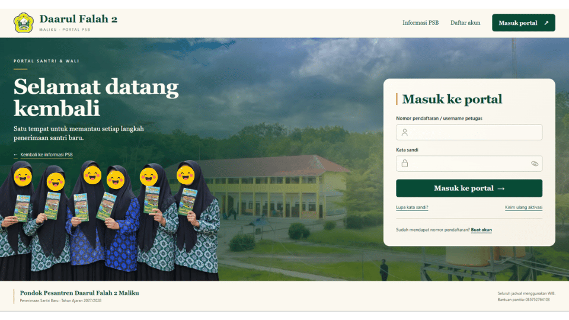

# Portal Penerimaan Santri Baru

Salinan berkas per santri ke Google Drive privat: [aktivasi dan aturan penyimpanan](docs/integrasi-google-drive.md). Memerlukan izin OAuth Drive terpisah; sinkronisasi Sheets tetap tersedia.

Peluncuran portal dan Sheets otomatis setelah login Windows: [panduan startup Windows](docs/startup-windows.md).

Salinan biodata ke Google Sheets dengan OAuth Desktop dan tab MI/MTS/MA: [panduan koneksi dan sinkronisasi](docs/integrasi-google-sheets.md). Memerlukan login dan preview sebelum penulisan pertama.

Migrasi ke MySQL/MariaDB untuk dilihat melalui phpMyAdmin: [panduan dan skrip migrasi](docs/migrasi-mysql.md). SQLite tetap digunakan selama DATABASE_URL belum diisi.

Aplikasi untuk Pondok Pesantren Daarul Falah 2 Maliku, tahun ajaran 2027/2028, jenjang MI, MTs, dan MA. Antarmuka berbahasa Indonesia. Seluruh jadwal operasional menggunakan Asia/Jakarta.

Python, Flask, SQLite WAL, Jinja, dan penyimpanan privat digunakan agar aplikasi dapat dijalankan pada satu server tanpa layanan database tambahan. Transaksi keuangan dan penerbitan nomor dilindungi transaksi database serta indeks unik. Pemisahan peran diterapkan pada server.

## Menjalankan di Windows

Jalankan dari direktori proyek dengan Python 3.12 atau lebih baru. Lingkungan pengembangan saat ini memakai Python 3.14.

```powershell
python -m venv .venv
.\.venv\Scripts\python.exe -m pip install -r requirements.lock.txt
Copy-Item .env.example .env
.\.venv\Scripts\python.exe manage.py init
.\.venv\Scripts\python.exe manage.py demo
.\.venv\Scripts\python.exe run.py
```

Buka http://127.0.0.1:5000. Berkas `.env` hanya perlu disalin sekali. Jika lingkungan `.venv` dan data demo sudah tersedia, cukup jalankan `run.py`.

### Akses dari HP melalui Wi-Fi yang sama

Konfigurasi lokal kini memakai `LISTEN=auto` dan `BASE_URL=auto`. Saat menjalankan `run.py`, alamat komputer dan HP ditampilkan di terminal berdasarkan IP saat itu. Jika berpindah jaringan ketika aplikasi berjalan, hentikan dengan Ctrl+C dan jalankan kembali agar IP dideteksi ulang. Alamat komputer selalu `http://127.0.0.1:5000/login` selama server aktif. Contoh IP di bawah mengikuti jaringan saat dokumentasi sebelumnya ditulis.

Konfigurasi lokal saat ini membuka `http://10.149.158.185:5000` melalui Wi-Fi komputer. Buka alamat tersebut pada browser HP, dengan komputer tetap menyala dan server berjalan.

Variabel `LISTEN` di `.env` berisi alamat pendengar server, dipisahkan spasi. Variabel `BASE_URL` menjadi alamat pada tautan dan QR yang dihasilkan aplikasi. Jika IP Wi-Fi komputer berubah, perbarui kedua variabel lalu mulai ulang `run.py`. Konfigurasi contoh tetap menggunakan loopback secara default.

```dotenv
LISTEN=127.0.0.1:5000 10.149.158.185:5000
BASE_URL=http://10.149.158.185:5000
```

Pemeriksaan HTTP pada alamat Wi-Fi dapat dijalankan dengan `.venv\Scripts\python.exe scripts\smoke_local.py --base-url http://10.149.158.185:5000`.

Data demo berisi tiga peserta fiktif dan empat akun petugas. Password acak tersimpan pada `instance/akun-demo.txt`. Data tersebut dibuat lokal dan dikecualikan dari Git.

| Username | Akses |
| --- | --- |
| admin.demo | Admin Utama |
| bendahara.demo | Bendahara |
| berkas.demo | Pemberkasan |
| rangkap.demo | Ketua PSB (Admin, Bendahara, Pemberkasan) |
| MI-01, MTS-01, MA-01 | Wali peserta masing-masing |

Untuk data operasional, pilih `DATA_DIR` yang berbeda dan jalankan `manage.py admin`. Perintah ini meminta password melalui terminal. Admin dapat membuat petugas dan mengatur peran dari halaman Pengaturan. Pembuatan demo hanya diperbolehkan pada database kosong.

## Fitur yang dapat dijalankan

- Pendaftaran online dengan tautan pemantauan, unggah ulang bukti, dan penerbitan nomor setelah pembayaran disahkan.
- Pendaftaran langsung oleh Bendahara, konfirmasi tunai, dan kuitansi PDF.
- Pembuatan akun dengan pencocokan data awal, aktivasi email, login nomor pendaftaran, reset password, serta pengaturan password.
- Biodata, formulir PDF, tanggal tes, kartu PDF ber-QR, pemindahan/pembatalan, dan absensi melalui pencarian atau kamera yang didukung browser.
- Hasil draf, publikasi per peserta, koreksi beralasan, surat kelulusan PDF dan Word, serta verifikasi keabsahan publik.
- Unggahan identitas privat, pemeriksaan setiap berkas, KTP wali sebagai pengganti spesifik, serta ketentuan SKL dan ijazah menyusul.
- Tagihan berversi, pembayaran maksimal dua kali, verifikasi transfer, koreksi transaksi, dan bukti daftar ulang yang mengikuti status terbaru.
- Ekspor Excel pendaftaran/pembayaran, pengaturan rekening/template/petugas, audit, serta antrean notifikasi.

## Konfigurasi yang masih diperlukan

Tanggal buka/tutup, kontak panitia, rekening, biaya daftar ulang per jenjang, tenggat cicilan pertama, kop, template, format nomor surat, dan penandatangan diisi Admin Utama setelah tersedia. Formulir dan surat default bertanda DRAF.

Notifikasi default memakai mode simulasi. Email aktivasi/reset dapat dikirim langsung melalui Gmail setelah SMTP lokal diaktifkan; panduannya ada di [docs/integrasi-email-gmail.md](docs/integrasi-email-gmail.md). Worker notifikasi otomatis memeriksa antrean tiap 30 detik setelah portal dimulai. WhatsApp tetap memerlukan n8n serta WhatsApp Business API. Workflow impor tersedia di `n8n/psb-notifikasi.json`.

Template dikelola melalui teks, kop teks, penandatangan, dan pola nomor. Pengelolaan tahun berikutnya memerlukan penetapan kebijakan penomoran dan migrasi tambahan. Pemeriksaan visual browser dan eksekusi workflow dengan layanan nyata belum selesai. Rincian hasil uji dan batasan tersedia pada dokumentasi progres.

## Pengujian dan pemeliharaan

```powershell
.\.venv\Scripts\python.exe -m pytest -q
.\.venv\Scripts\python.exe manage.py reminders
.\.venv\Scripts\python.exe manage.py worker
.\.venv\Scripts\python.exe manage.py backup
```

Pengujian menggunakan database sementara dan data fiktif. Pengujian mencakup alur HTTP dari pengajuan sampai selesai, isolasi akun, peran rangkap, nomor bersamaan, aktivasi/reset, dokumen berversi, pembayaran, koreksi, ekspor, dan outbox.

Hasil terakhir pada 12 November 2026 mencapai 36 pengujian lulus. `scripts/smoke_local.py` juga memeriksa login dan halaman utama melalui server Waitress yang berjalan menggunakan akun demo lokal.

Halaman masuk menggunakan logo dan foto yang diberikan pengguna, dengan tata letak desktop serta HP. Catatan aset dan pemeriksaan visual tersedia di [docs/desain-login.md](docs/desain-login.md). Setelah memasang `requirements-dev.txt`, pratinjau empat ukuran layar dapat diulang dengan `python scripts/preview_portal.py` saat server aktif.

Animasi halaman, formulir yang dapat dibuka-tutup, dan tombol mengikuti preferensi kurangi gerakan perangkat. Uji interaksinya menggunakan `python scripts/check_motion.py` saat server dan data demo tersedia.

Dashboard setelah login menyediakan menu bergaya aplikasi, progres peserta dalam enam tahap, navigasi bawah untuk HP, serta sidebar desktop. Biodata, jadwal/kartu, hasil, berkas, pembayaran, dokumen, dan pemberitahuan membuka halaman masing-masing. Detailnya tersedia di [docs/desain-dashboard.md](docs/desain-dashboard.md). Pratinjau seluruh peran dapat diulang menggunakan `python scripts/preview_dashboard.py`.

## Struktur proyek

| Lokasi | Kegunaan |
| --- | --- |
| psb/app.py | Rute halaman dan pemeriksaan izin |
| psb/domain.py | Aturan bisnis dan perubahan status |
| psb/security.py | Sesi, CSRF, peran, pembatasan permintaan |
| psb/db.py dan migrations/ | Koneksi, transaksi, dan migrasi |
| psb/files.py | Unggahan privat, PDF, QR, dan Word |
| psb/reports.py | Laporan Excel |
| psb/notifications.py dan n8n/ | Outbox, pengingat, webhook, callback |
| templates/ dan static/ | Antarmuka responsif |
| tests/ | Pengujian otomatis |
| instance/ | Database, unggahan, dan akun demo lokal |
| docs/ | Kebutuhan, progres, akses, integrasi, dan operasi |

Panduan konfigurasi layanan, deployment, pencadangan, dan pemulihan tersedia di [docs/deployment.md](docs/deployment.md). Aturan akses dirangkum pada [docs/hak-akses.md](docs/hak-akses.md). Progres lintas sesi dicatat pada [docs/tahapan-pengerjaan.md](docs/tahapan-pengerjaan.md).
